## Actividad 7

### Ronda 0 — Configuración del proyecto

**Proyecto creado**

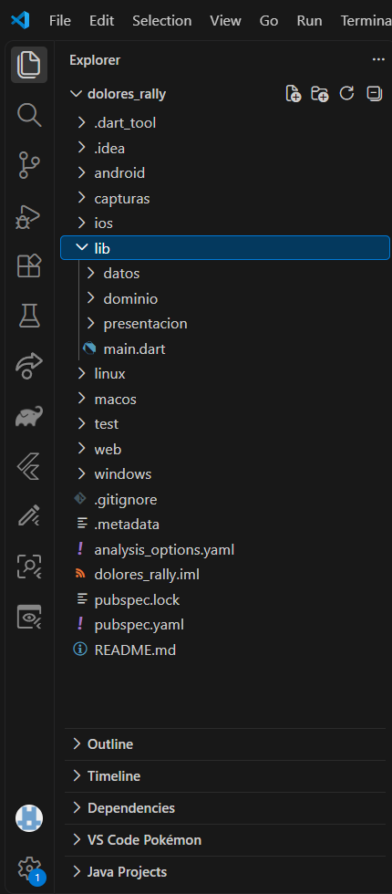

**Dependencias instaladas**

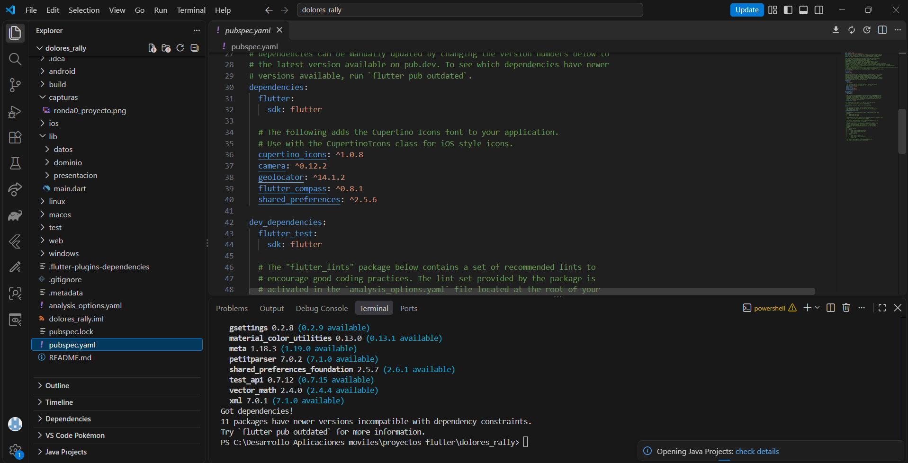

**Análisis inicial**

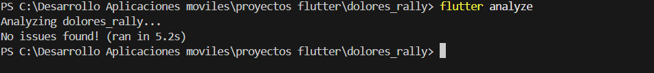

### Ronda 1 — Diseño del juego

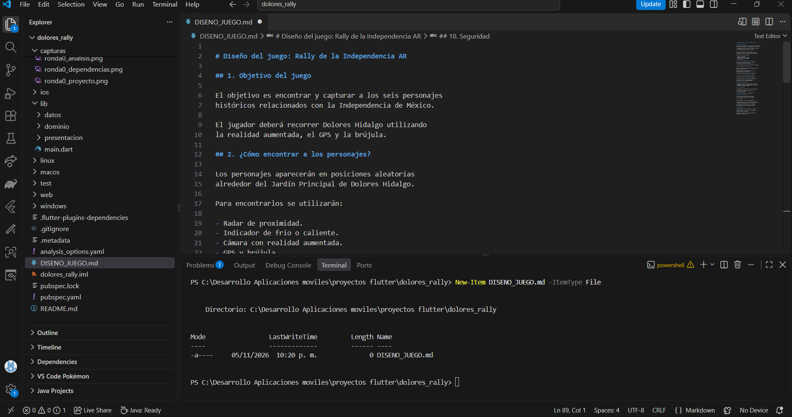

### Ronda 2 — Geometría y coordenadas

**ROJO: pruebas antes de implementar**

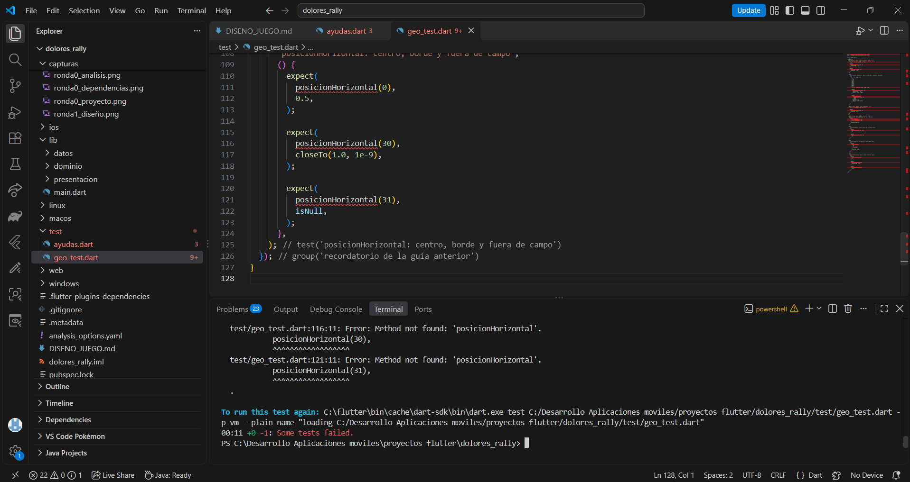

**VERDE: pruebas corregidas**

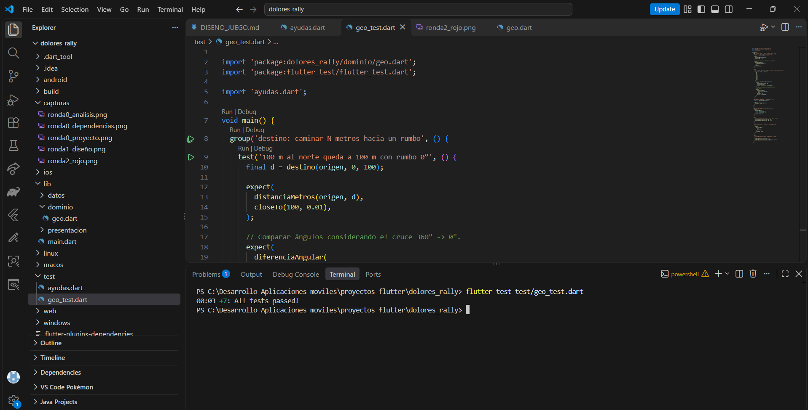

### Ronda 3 — Personajes y preguntas

**Modelos**

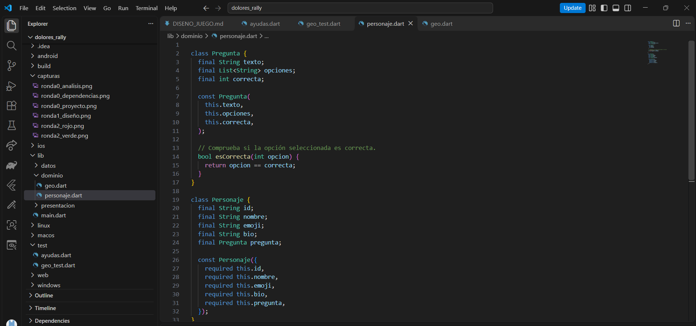

**Catálogo histórico**

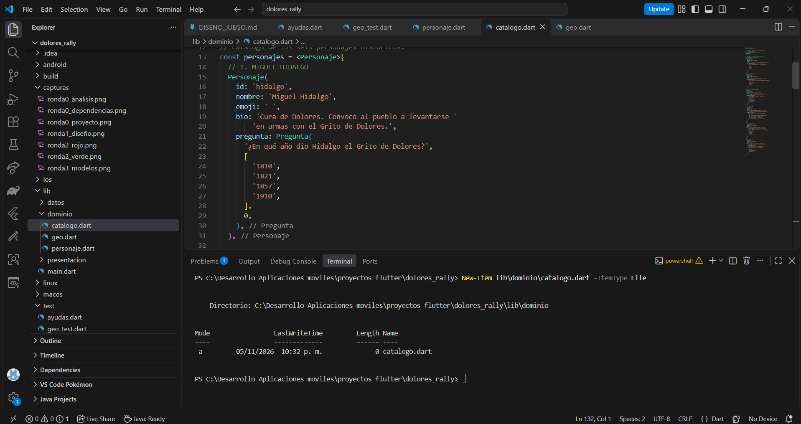

### Ronda 4 — Apariciones aleatorias

**ROJO**

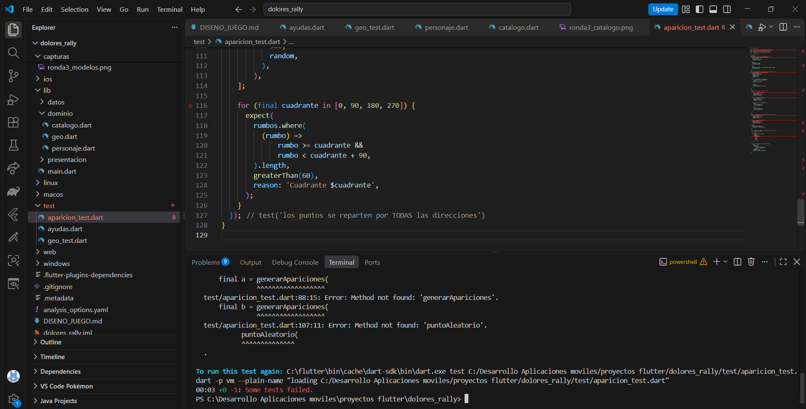

**VERDE**

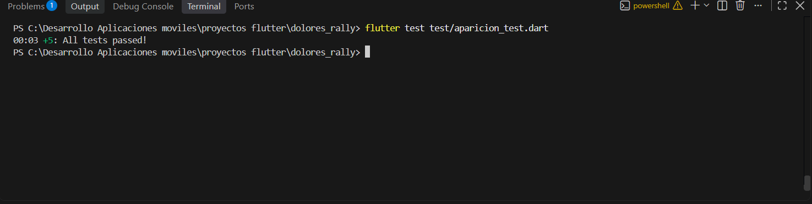

### Ronda 5 — Radar y proximidad

**ROJO**

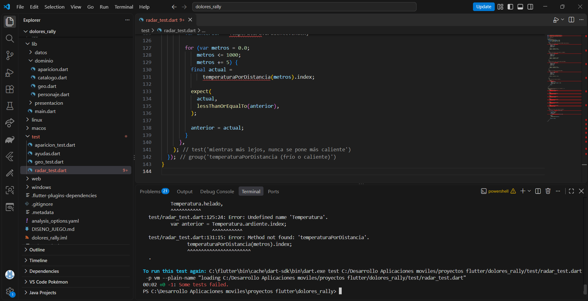

**VERDE**

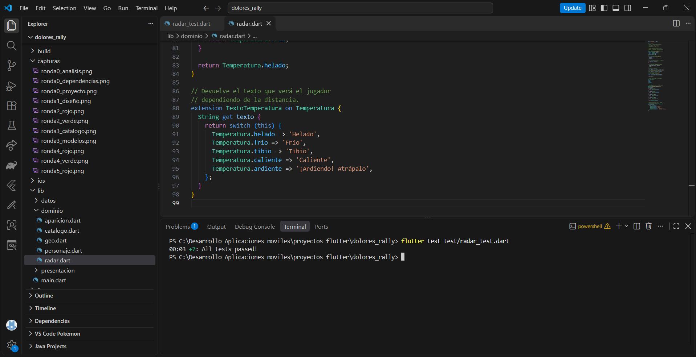

### Ronda 6 — Motor de realidad aumentada

al.

**ROJO**

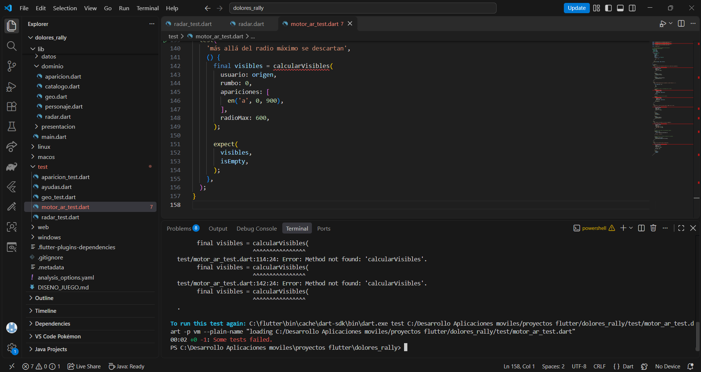

**VERDE**

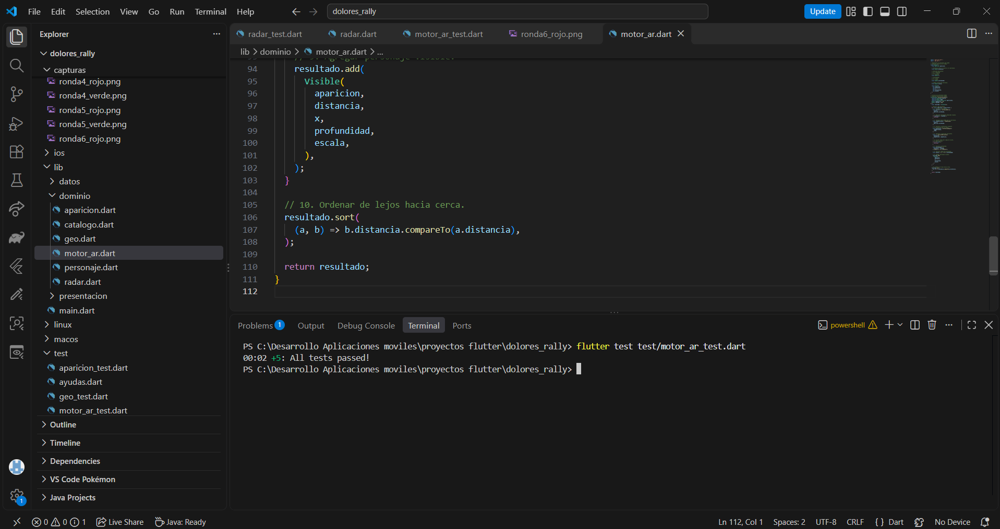

### Ronda 7 — Reglas de la partida

**ROJO**

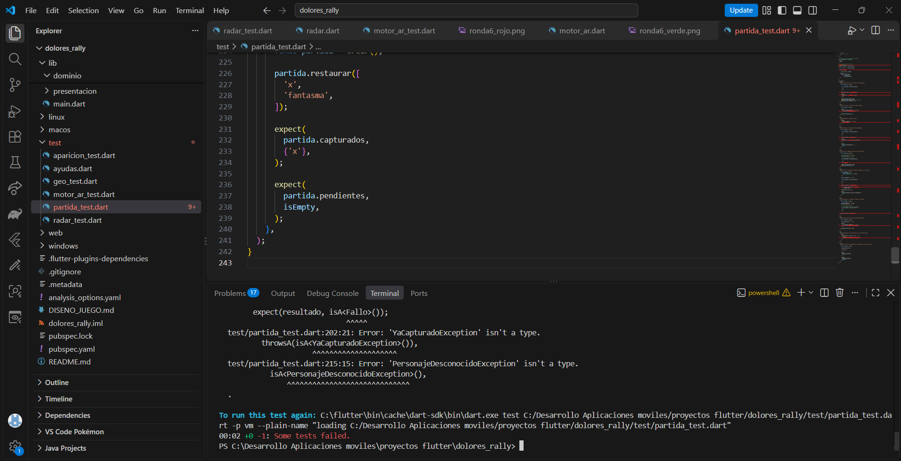

**VERDE**

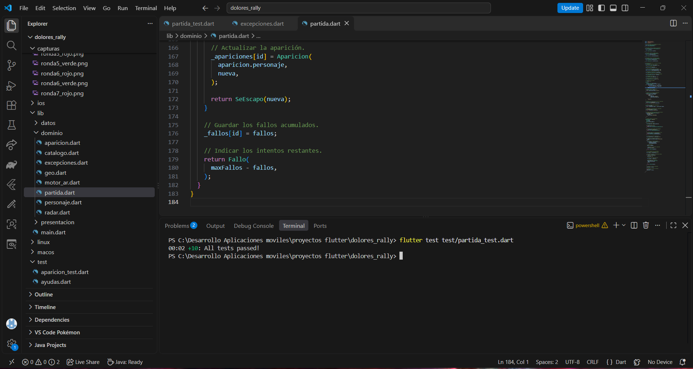

### Ronda 8 — Almacenamiento del álbum

**ROJO**

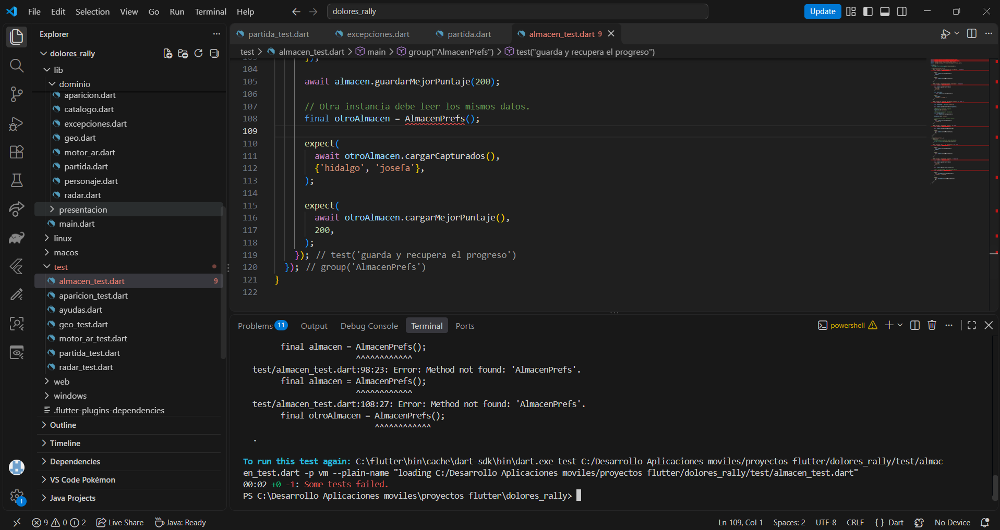

**VERDE**

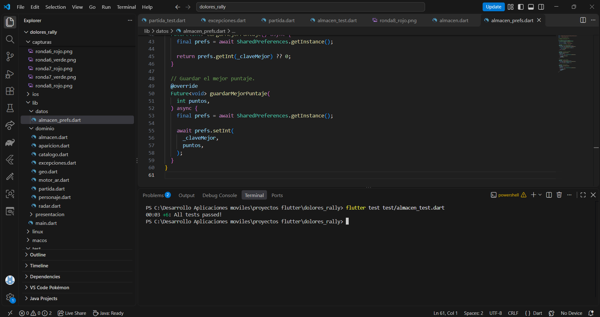

### Ronda 9 — GPS y brújula

**Contratos de sensores**

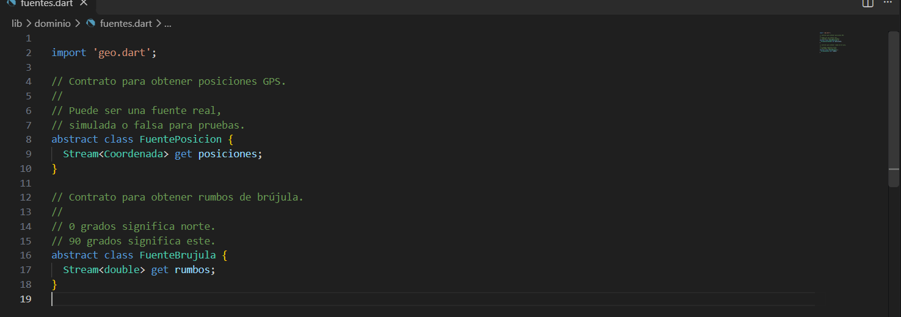

**Fuentes reales**

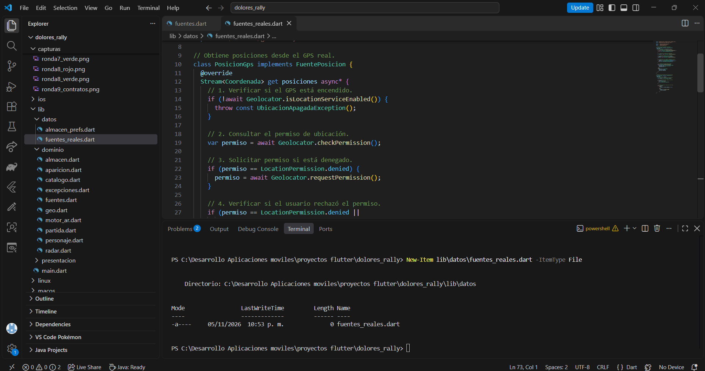

### Ronda 10 — ViewModel del juego

**ROJO**

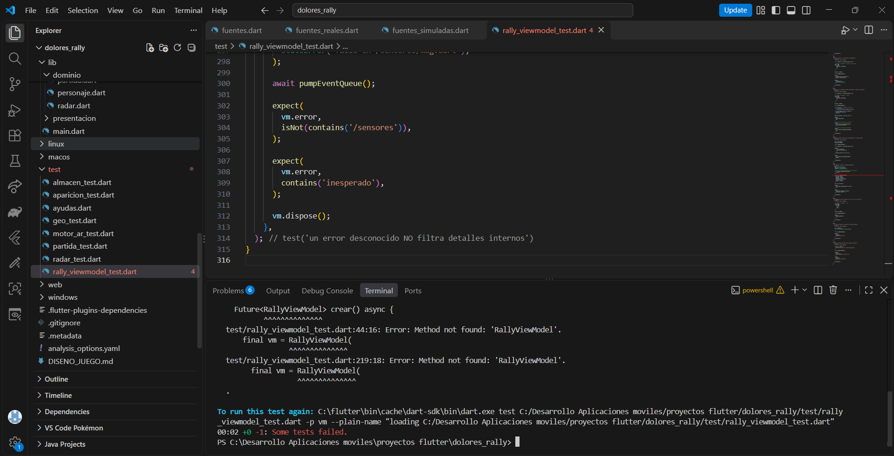

**VERDE**

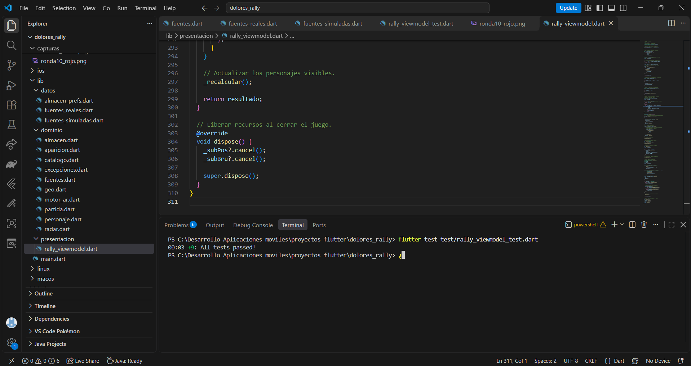

